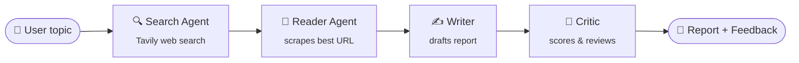

# 🔎 Multi-Agent Research Assistant

A multi-agent AI system that researches any topic on the web, reads the best sources, writes a structured report, and then critiques its own work, all from a simple Streamlit UI.

Built with **LangChain**, **Ollama**, **Tavily**, and **Streamlit**.

---

## ✨ How it works

Four specialised agents work together in a pipeline, each passing its output to the next:



| Step | Component | What it does |
|------|-----------|--------------|
| 1 | **Search Agent** | Uses the `web_search` tool (Tavily) to find recent, reliable information on the topic |
| 2 | **Reader Agent** | Picks the most relevant URL from the search results and scrapes it with `scrape_url` for deeper content |
| 3 | **Writer Chain** | Combines search results and scraped content into a structured report: Introduction, Key Findings, Conclusion, Sources |
| 4 | **Critic Chain** | Reviews the report and returns a score out of 10, strengths, areas to improve, and a one-line verdict |

The search and reader steps are **tool-using agents** (`create_agent`), so the LLM decides how to call its tool. The writer and critic are **prompt chains** (`prompt | llm | parser`).

### Robust web scraping

`scrape_url` tries three extraction strategies in turn, so it still gets text from pages that one method can't parse:

1. **trafilatura**: best for articles and blogs
2. **readability-lxml**: pulls out the main content block
3. **BeautifulSoup**: falls back to the full page text, with nav, header, footer and scripts stripped out

---

## 🛠️ Tech stack

| Layer | Tools |
|-------|-------|
| Agents & chains | [LangChain](https://python.langchain.com/) |
| LLM | [Ollama](https://ollama.com/) (`gemma4:31b-cloud`; any Ollama model works) |
| Web search | [Tavily](https://tavily.com/) |
| Scraping | trafilatura, readability-lxml, BeautifulSoup |
| Frontend | [Streamlit](https://streamlit.io/) |
| Language | Python 3.12 |

---

## 📁 Project structure

```
multi-agents/
├── src/
│   ├── agent/
│   │   └── agents.py        # LLM setup, search & reader agents, writer & critic chains
│   ├── pipelines/
│   │   └── pipeline.py      # run_research_pipeline(): orchestrates the 4 steps
│   ├── tools/
│   │   └── tools.py         # web_search (Tavily) and scrape_url tools
│   ├── app.py               # Streamlit frontend
│   └── main.py              # CLI entry point for quick testing
├── pyproject.toml           # makes `src` an installable package
├── requirements.txt
└── .env                     # API keys (not committed)
```

---

## 🚀 Getting started

### Prerequisites

- Python 3.12+
- [Ollama](https://ollama.com/download) installed and running
- A free [Tavily API key](https://app.tavily.com/)

### 1. Clone and install

```bash
git clone https://github.com/vishalyadav28/multi-agent-system.git
cd multi-agent-system

python -m venv .venv
source .venv/bin/activate        # Windows: .venv\Scripts\activate
pip install -r requirements.txt  # also installs this project in editable mode
```

### 2. Set up the model

```bash
ollama signin                    # needed for cloud models like gemma4:31b-cloud
ollama pull gemma4:31b-cloud
```

> To use a different model, change the `model=` value in `src/agent/agents.py`, for example to `llama3.2:3b` to run fully locally.

### 3. Add your API key

Create a `.env` file in the project root:

```env
TAVILY_API_KEY=your_tavily_api_key
```

### 4. Run

**Streamlit UI**

```bash
streamlit run src/app.py
```

Open http://localhost:8501, enter a topic, and click **Run research**.

**Command line**

```bash
python src/main.py
```

---

## 🧩 Using the tools directly

The tools are LangChain `StructuredTool`s, so call them with `.invoke()`:

```python
from src.tools.tools import web_search, scrape_url

web_search.invoke({"query": "latest news on AI agents"})
scrape_url.invoke({"url": "https://example.com/article"})
```

Or run the whole pipeline from Python:

```python
from src.pipelines.pipeline import run_research_pipeline

state = run_research_pipeline("Impact of AI on jobs")
print(state["report"])
print(state["feedback"])
```

---

## 🗺️ Roadmap

- [ ] Feed the critic's feedback back to the writer (self-improvement loop)
- [ ] Scrape multiple sources instead of one
- [ ] Stream each agent's progress live in the UI
- [ ] Expose the pipeline as a FastAPI endpoint
- [ ] Export reports as PDF / Markdown

---

## 🙌 Acknowledgements

Built while learning multi-agent systems with LangChain. Feedback and suggestions are welcome.
